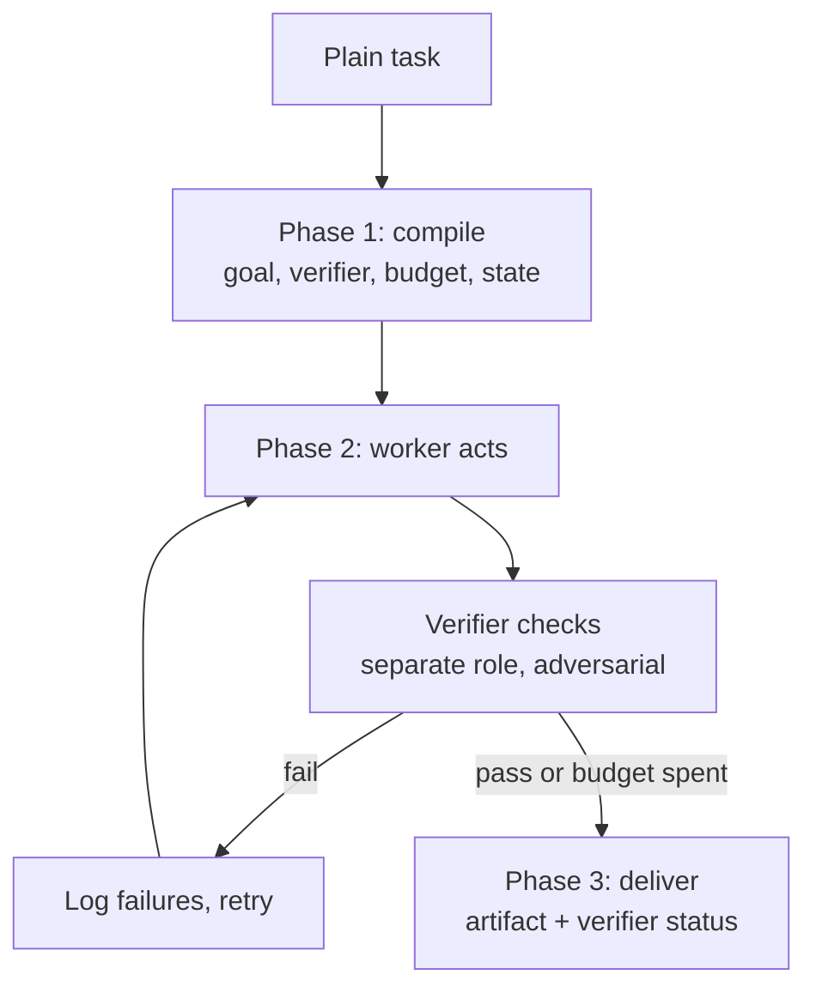

<p align="center">
  
</p>

# Loopify

Turn a plain task into a self-verifying loop, run it, and get back a
verified result instead of a first draft.

Works in Claude, ChatGPT, Gemini and Grok. The logic lives in one plain
markdown file; each platform just gets a thin wrapper.

## What it does

You give it a normal task. Instead of answering immediately, it writes a
verifier, runs a work-and-check cycle against that verifier, and only then
hands you the output — along with an honest note on how trustworthy the
verification actually was.



## Install

### Claude (skill — recommended)
```bash
./build.sh
```
Then upload `loopify.zip` in Claude's skill settings.
Triggers automatically; or type `use loopify` to force it.

Skills load on demand, so an idle Loopify costs a small amount of context
instead of re-sending the full instructions on every message.

### Claude (project)
Paste `core/loopify.md` into a project's custom instructions.
Simpler, but it loads on every message in that project.

### ChatGPT
New **Custom GPT** → paste `adapters/chatgpt.md` into Instructions.

### Gemini
New **Gem** → paste `adapters/gemini.md` into Instructions.

### Grok
Paste `adapters/grok.md` at the top of a new conversation.

## Usage

```
loopify: rewrite this landing page copy so it converts better
loopify: find every place this repo reads env vars without a default
loopify: draft a two-week onboarding plan for a junior analyst
```

Or just describe the task — in Claude the skill triggers on its own.

## The honest caveat

Loop quality is bounded by how external the verifier's signal is.

| Signal | Quality | Example |
|---|---|---|
| Real execution | Strong | tests run, linter run, schema validated |
| Falsifiable rubric | Medium | word count, required sections, one CTA |
| Self-assessment | Weak | "this reads well now" |

In a plain chat window the worker and the verifier are the same model in
the same context, which biases the verifier toward passing. Loopify
switches roles and forbids evidence-free passes to reduce that, but it
cannot remove it. The skill tells you which tier you got, every run.

If you want strong loops, run it somewhere it can execute things —
Claude Code, or any agent with a shell.

## Structure

```
loopify/
├── SKILL.md              Claude wrapper
├── core/
│   ├── loopify.md        the actual logic, portable
│   ├── verifiers.md      check patterns by task type
│   └── examples.md       worked examples
├── adapters/             one file per platform
├── tools/
│   └── banner.js         regenerates banner.svg
├── banner.svg            README header
├── build.sh              makes loopify.zip
└── LICENSE
```

## Banner

The header image is generated, not hand-drawn:

```bash
node tools/banner.js
```

Colors live in two constants at the top of that file — `FILL` for the
block faces, `SHAD` for the offset outline.

## License

[](LICENSE)
